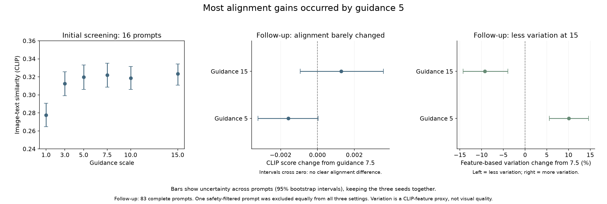
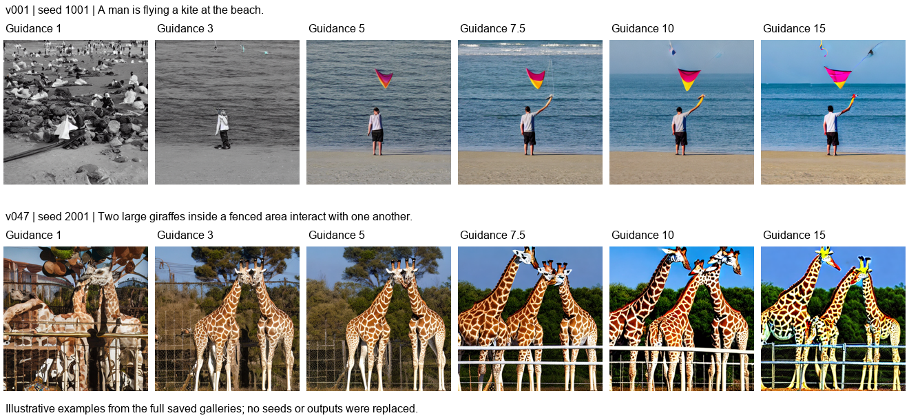

# Milestone 2 - Guidance-scale experiment

Yosephine Tong

## What was tested

This experiment tested whether stronger guidance helped Stable Diffusion v1.5 follow a caption while preserving variation between images. The PNDM sampler, 25 sampling steps and 512 x 512 image size stayed fixed. No training was performed.

Six guidance settings (1, 3, 5, 7.5, 10 and 15) were first compared on 16 validation prompts. Guidance 5 and 15 were then tested against the default 7.5 on the other 84 prompts. Each setting used the same three random starting points for each prompt.

## What the results showed

Increasing guidance from 1 toward 5 improved the CLIP image-text score. Guidance 1 was noticeably weaker; the results did not suggest that every value from 1 to 5 worked equally well. Above about 5, further gains were small.

In the larger follow-up, 15 scored slightly higher than 7.5, but the difference was too small and uncertain to establish an improvement. Images also became more similar across random starting points as guidance increased.

| Guidance | Image-text score | Variation compared with 7.5 |
| --- | --- | --- |
| 5 | 0.3134 | About 10% more |
| 7.5 | 0.3150 | Reference setting |
| 15 | 0.3163 | About 9% less |

The table used 83 complete prompts equally across settings after one output was safety-filtered. CLIP measured image-text similarity and differences between image features; neither measure directly established visual quality.

The middle panel's uncertainty bars crossed zero: neither alternative showed a clear alignment difference from 7.5.

Moderate guidance clarified the kite scene. In the giraffe scene, higher guidance added an extra animal. Stronger guidance could therefore reinforce the general scene while making a specific detail wrong.

## Conclusion

Guidance 5-7.5 was a useful working range for this pipeline, although no optimal value was established. Guidance 15 offered no convincing alignment benefit to offset its lower measured variation and visible artifacts.
