

IE 7615 Deep Learning for AI · Group 1 · Text-to-Image Generation Using Transformer and Diffusion Models

<h1>Project 2 – Milestone 1: Baseline Generation Analysis</h1>

Aditi Rao

## 1. Introduction and Methodology

We used pretrained Stable Diffusion v1.5 to generate images from 16 text prompts selected from the COCO 2017 validation dataset. The goal was to evaluate how well generated images matched their descriptions compared with the original photographs, establishing a baseline for future improvements. We used Google Colab with a T4 GPU and Hugging Face Diffusers. Each image was generated using 25 inference steps and a fixed random seed to ensure reproducibility. We then downloaded the original COCO images and created a side-by-side gallery, comparing subjects, object counts, spatial relationships, and composition.

## 2. Results and Observations

Overall, Stable Diffusion generated recognizable images that matched most prompts but struggled with details. The strongest results came from simpler prompts. For example, p01 generated a kitchen with a white island and bowl of greens, although the layout differed from the original. Similarly, p13 captured a tennis player wearing white shorts. The model struggled with multiple objects and specific arrangements. In p02, it did not accurately represent three desserts and two wine glasses. Similarly, p08 included cats and computer equipment but did not match their requested positioning. Several generated images appeared more staged than the originals. For example, p09 produced a professional-looking wedding photograph instead of a casual street scene, while p12 generated a posed image of a woman and dog. The model also missed specific features. In p14, it generated a bedroom without the green bed netting described in the prompt. Overall, the model performed best with recognizable subjects but struggled with quantities, object relationships, and specific details.

## 3. Connection to Deep Learning Concepts

### Conditional Sampling

Stable Diffusion uses conditional sampling, where text prompts guide image generation. Most images included the main subjects described but differed from the original photographs because the model received only text descriptions, not the original images. For example, p09 produced a wedding scene matching the prompt but differing significantly from the original, demonstrating how conditional sampling allows different visual interpretations.

### Latent Representations

Stable Diffusion uses latent representations, or compressed visual information. Rather than performing diffusion on full-resolution images, it works in a lower-dimensional latent space before decoding the result. These representations allow the model to generate recognizable scenes using learned patterns. However, p08 showed that generating individual objects does not guarantee their correct arrangement.

### Mode Collapse Risk

Mode collapse occurs when generative models produce limited output variety. Although commonly associated with GANs, output diversity is also relevant to diffusion models. Some images favored familiar compositions, such as the staged wedding scene in p09 and posed woman and dog in p12. However, one image per prompt is insufficient to determine whether the model has a diversity problem. Testing multiple random seeds would help evaluate variation.

### Generative vs. Discriminative Models

Generative models create new data from learned patterns, while discriminative models classify or predict labels from existing data. For example, a discriminative model might identify a cat in an image, while a generative model could create a cat image from text. Stable Diffusion is generative because it creates new images from prompts rather than classifying photographs. Our results were new interpretations of captions, not copies of the original COCO images.

## 4. Limitations and Future Improvements

One limitation was generating only one image per prompt. Although fixed seeds ensured reproducibility, testing multiple seeds would help evaluate consistency and diversity. Our evaluation was qualitative, without quantitative metrics. Future experiments could use CLIP similarity to measure how closely images match their descriptions and Fréchet Inception Distance (FID) to compare real and generated image distributions using a larger sample. We could also test different guidance scales and inference steps to improve image quality and accuracy.

## 5. Conclusion

Overall, Stable Diffusion v1.5 generated recognizable images matching the main subjects and settings described in the prompts. However, it struggled with object counts, spatial relationships, and details. Some images also appeared more staged than the originals. These findings establish a baseline for evaluating whether future changes improve prompt accuracy, image quality, and consistency.

## Baseline Gallery

Each pair shows the original COCO photograph (left) and the Stable Diffusion v1.5 image generated from its caption (right), with 25 inference steps and the listed seed. The full-resolution comparison sheet and the generation notebook are in the repository under reports/ and notebooks/.

<!-- gallery:start -->

<figure>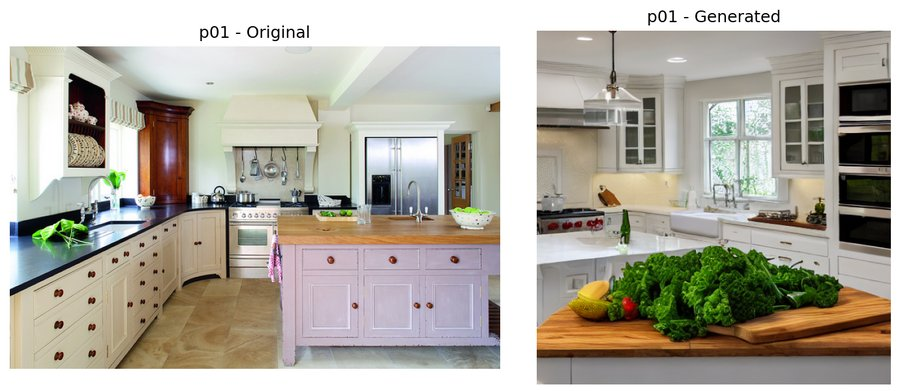<figcaption><b>p01</b> A kitchen with a center white island topped with a bowl of greens. Original: COCO 565776, <a href="http://farm7.staticflickr.com/6160/6206762667_b852ea9b7e_z.jpg">Flickr</a>, CC BY 2.0. Seed 42.</figcaption></figure>
<figure>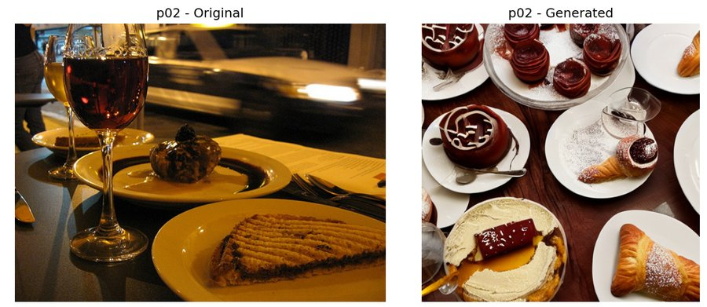<figcaption><b>p02</b> Three pastry desserts and two glasses of wine are on a table. Original: COCO 416885, <a href="http://farm4.staticflickr.com/3040/2791132570_faa5072ab9_z.jpg">Flickr</a>, CC BY 2.0. Seed 43.</figcaption></figure>
<figure>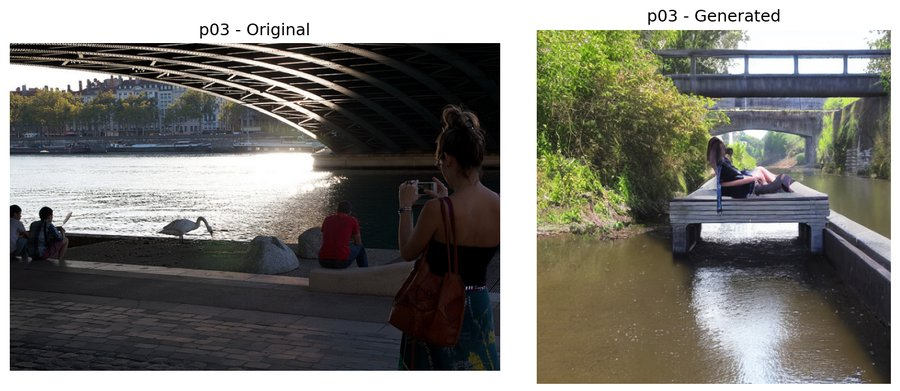<figcaption><b>p03</b> A waterway under a bridge with people sitting down and a woman taking a photo. Original: COCO 1268, <a href="http://farm6.staticflickr.com/5454/9413846304_881d5e5c3b_z.jpg">Flickr</a>, CC BY 2.0. Seed 44.</figcaption></figure>
<figure>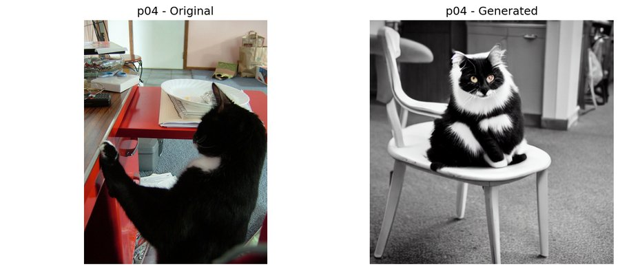<figcaption><b>p04</b> A black and white cat sitting on top of a chair. Original: COCO 231831, <a href="http://farm3.staticflickr.com/2324/2242089027_800a938327_z.jpg">Flickr</a>, CC BY-SA 2.0. Seed 45.</figcaption></figure>
<figure>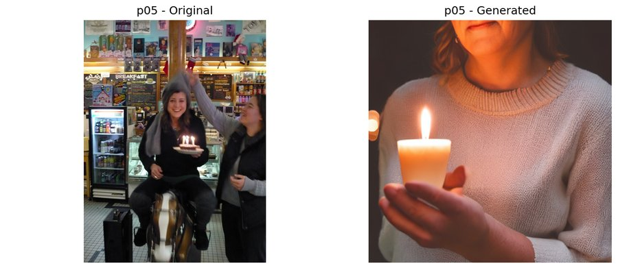<figcaption><b>p05</b> A woman holding a small cake with lit candles. Original: COCO 213547, <a href="http://farm3.staticflickr.com/2062/2243132921_779f9cdc24_z.jpg">Flickr</a>, CC BY 2.0. Seed 46.</figcaption></figure>
<figure>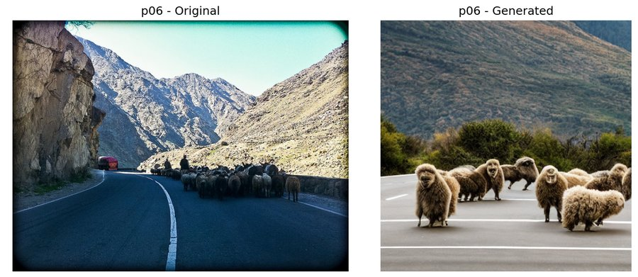<figcaption><b>p06</b> A flock of animals stand on the road near mountains. Original: COCO 140583, <a href="http://farm3.staticflickr.com/2081/5751829875_65da860dba_z.jpg">Flickr</a>, CC BY-SA 2.0. Seed 47.</figcaption></figure>
<figure>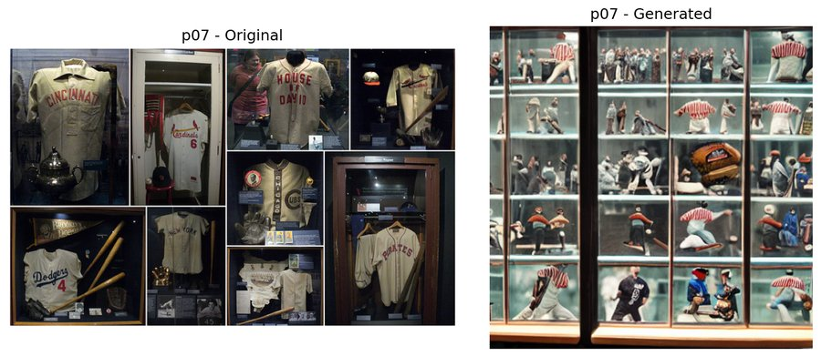<figcaption><b>p07</b> Baseball memorabilia is displayed in glass stacked casings. Original: COCO 231747, <a href="http://farm3.staticflickr.com/2740/5763708656_0879336a58_z.jpg">Flickr</a>, CC BY 2.0. Seed 48.</figcaption></figure>
<figure>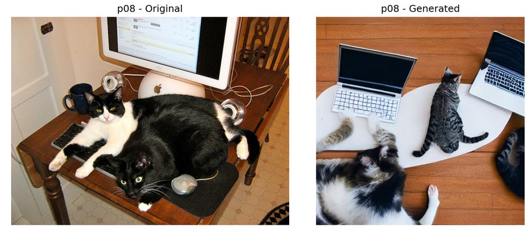<figcaption><b>p08</b> The two cats are laying beside of the computer on the keyboard. Original: COCO 333772, <a href="http://farm5.staticflickr.com/4038/4212612461_ca16f4e7fb_z.jpg">Flickr</a>, CC BY 2.0. Seed 49.</figcaption></figure>
<figure>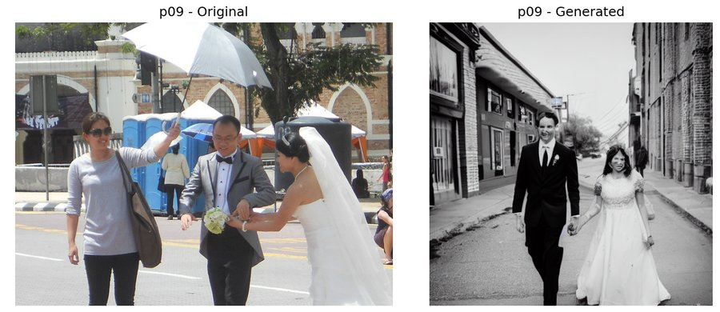<figcaption><b>p09</b> A newly married couple walking down a street. Original: COCO 496854, <a href="http://farm3.staticflickr.com/2795/5715794037_73f069675d_z.jpg">Flickr</a>, CC BY-SA 2.0. Seed 50.</figcaption></figure>
<figure>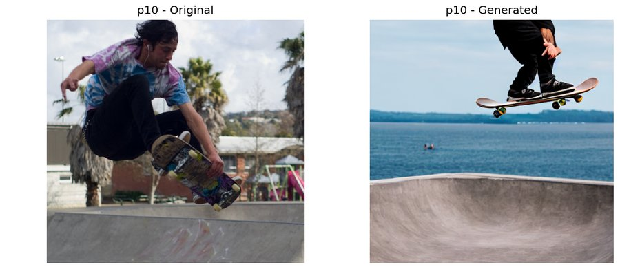<figcaption><b>p10</b> The skateboarder wears headphones while jumping to grab his board. Original: COCO 22479, <a href="http://farm4.staticflickr.com/3447/3880630600_2c837dbf23_z.jpg">Flickr</a>, CC BY-SA 2.0. Seed 51.</figcaption></figure>
<figure>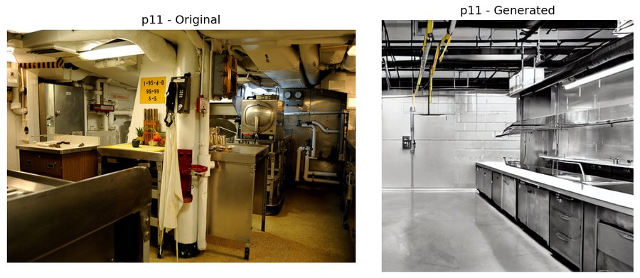<figcaption><b>p11</b> A clean industrial kitchen with no one in it Original: COCO 78266, <a href="http://farm7.staticflickr.com/6167/6180130159_ae0bf83d72_z.jpg">Flickr</a>, CC BY 2.0. Seed 52.</figcaption></figure>
<figure>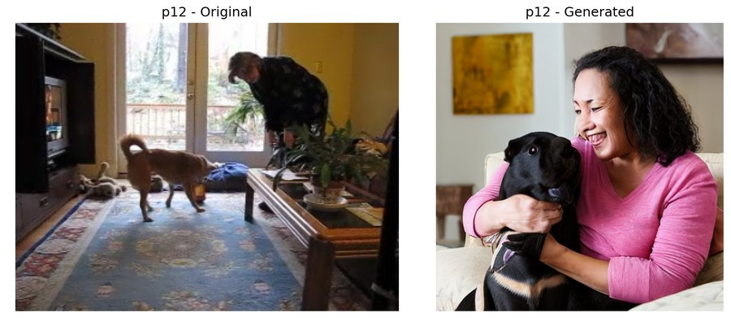<figcaption><b>p12</b> A woman in a living room with a dog. Original: COCO 404484, <a href="http://farm3.staticflickr.com/2645/4216057008_f835cc6fdf_z.jpg">Flickr</a>, CC BY-SA 2.0. Seed 53.</figcaption></figure>
<figure>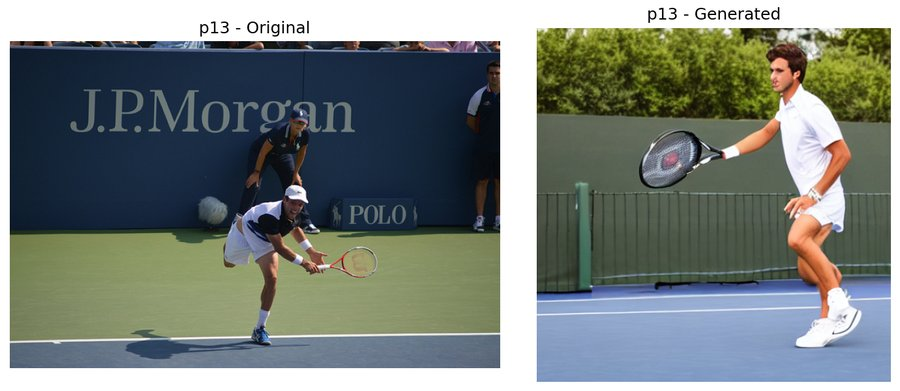<figcaption><b>p13</b> a male tennis player in white shorts is playing tennis Original: COCO 885, <a href="http://farm4.staticflickr.com/3715/9639200419_ee41490b2a_z.jpg">Flickr</a>, CC BY 2.0. Seed 54.</figcaption></figure>
<figure>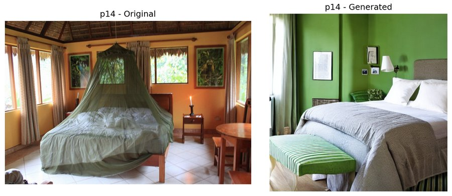<figcaption><b>p14</b> A green netted bed in a light filled bedroom. Original: COCO 10092, <a href="http://farm9.staticflickr.com/8276/8710590452_08a7a8f59c_z.jpg">Flickr</a>, CC BY-SA 2.0. Seed 55.</figcaption></figure>
<figure>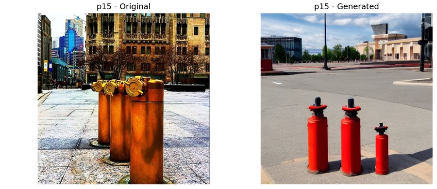<figcaption><b>p15</b> Three fire hydrants in front of a huge building. Original: COCO 28993, <a href="http://farm6.staticflickr.com/5006/5355925412_5e33918131_z.jpg">Flickr</a>, CC BY 2.0. Seed 56.</figcaption></figure>
<figure>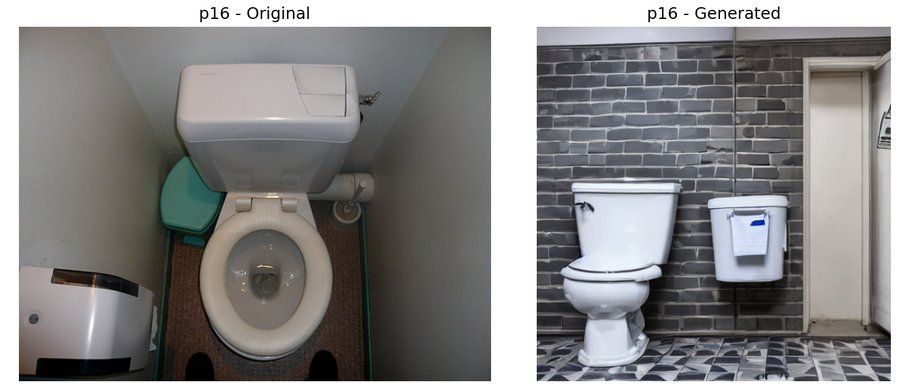<figcaption><b>p16</b> A white toilet sitting next to a trash can in a restroom. Original: COCO 38070, <a href="http://farm3.staticflickr.com/2068/2431080078_5c0ff7d4e8_z.jpg">Flickr</a>, CC BY-SA 2.0. Seed 57.</figcaption></figure>

<!-- gallery:end -->
