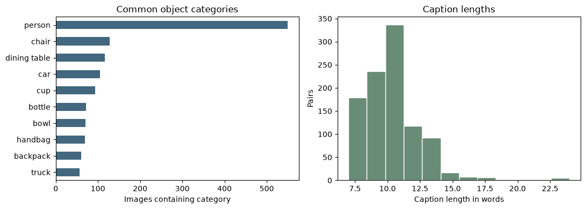

<section class="cover">

IE 7615EDGE: Deep Learning for AI

Generative Project

Text-To-Image Generation Using Transformer And Diffusion Models

Milestone 1

Group 1

Murat Akca Aditi Rao Dario Garza Yosephine Tong

akca.m@northeastern.edu rao.aditi3@northeastern.edu garza.d@northeastern.edu tong.yo@northeastern.edu

<b>Git Repo Link:</b> <a href="https://github.com/Yosephines/IE7615-Group1-Project2">github.com/Yosephines/IE7615-Group1-Project2</a>

<b>Submission Date:</b> October / 25 / 2026

</section>

## 1. Project Overview and Objectives

Project 2 builds a text-to-image pipeline that conditions a pretrained diffusion model on embeddings from a Transformer text encoder. Milestone 1 lays the foundation for that work. It has four objectives:

1. **Dataset:** curate a clean, licensed and reproducible image–caption subset with fixed splits.
2. **Environment and text→embedding pipeline:** set up a GPU environment and verify that CLIP turns captions and images into aligned embeddings end to end.
3. **Baseline generation:** generate images for representative dataset prompts with pretrained Stable Diffusion and compare them with the ground-truth photographs.
4. **Plan and repository:** write the project proposal and organize the team repository so later milestones build on the same data, code and conventions.

All four are complete. This report summarizes the methods, the results and what they mean for Milestones 2 and 3. The supporting documents, the proposal, the dataset memo and the baseline gallery with its analysis, are submitted alongside it and kept in the repository's `reports/` folder.

## 2. Methodology

### 2.1 Dataset: a curated COCO 2017 Captions subset

The dataset is a subset of COCO 2017 Captions [1], taken from the 5,000 validation images. COCO's everyday multi-object scenes match the project's goal, and COCO is the standard reference for text-to-image FID. The preparation script (`project/scripts/prepare_dataset.py`) builds the subset deterministically from a fixed seed (42):

- **Licensing:** only images marked Attribution (CC BY 2.0) or Attribution-ShareAlike (CC BY-SA 2.0) were eligible. Each manifest row records the Flickr source and license.
- **Caption cleaning:** Unicode (NFKC) and whitespace normalization; 5–35 words; no URLs; at least 50% alphabetic characters; case-insensitive deduplication. One caption was kept per image.
- **Image preprocessing:** EXIF orientation, RGB conversion, a minimum side of 128 pixels, exact-duplicate removal on decoded pixels and an aspect-preserving pad to 512 × 512 with neutral gray, saved as PNG. Padding keeps the whole scene and avoids stretching subjects. Normalization to [−1, 1] was verified for every image; CLIP applies its own preprocessing.
- **Visual review:** every final pair was checked against its image. Captions with wrong details were replaced by a clearer COCO caption or corrected, with the original wording retained. A perceptual-hash (dHash) screen flagged near-duplicate candidates for inspection.
- **Splits:** pairs were split by image into development (800), validation (100) and evaluation (100). No image appears in two splits.

### 2.2 Text→embedding pipeline: CLIP ViT-B/32

The embedding notebook uses the pretrained CLIP model `openai/clip-vit-base-patch32` [2] through Hugging Face Transformers. CLIP's text Transformer and image Vision Transformer were trained contrastively, so a caption and its image map to nearby points in a shared 512-dimensional space. The notebook tokenizes captions (padding and truncation to CLIP's 77-token limit), encodes images with the same padding as the dataset, L2-normalizes both embeddings and computes the cosine-similarity matrix. Image→text retrieval checks whether each image's most similar caption is its own. This serves as a functional test of the whole pipeline: a broken tokenizer, preprocessing step or pairing would push top-1 accuracy toward chance.

### 2.3 Baseline generation: Stable Diffusion v1.5

The baseline notebook generates one image per prompt with the pretrained `stable-diffusion-v1-5` pipeline from Hugging Face Diffusers, in half precision on a Colab T4 GPU. Stable Diffusion is a latent diffusion model [3]:

- A **VAE** encodes a 512 × 512 image into a 4 × 64 × 64 latent; diffusion runs in this compressed latent representation and the VAE decodes the result.
- A frozen **CLIP ViT-L/14 text Transformer** encodes the prompt into 77 token embeddings of size 768.
- A **U-Net** predicts the noise in the latent at each step and attends to the token embeddings through cross-attention, which is how the text conditions generation.
- **Classifier-free guidance** [4] runs the U-Net with and without the prompt and extrapolates toward the conditional prediction; the guidance scale controls how strongly the text steers sampling.

The 16 prompts in `data/baseline_prompts.csv` were fixed by the dataset preparation before any generation. They were chosen greedily from the evaluation split to cover as many object categories as possible. Each prompt has its own seed (42–57). Generation used 25 inference steps with the pipeline's default sampler (PNDM) and guidance scale (7.5). The original COCO photographs were downloaded for side-by-side comparison.

### 2.4 Environment and repository

| Component | Environment |
|-----|-------------|
| Dataset preparation | Local Python 3.13.9; versions pinned in `requirements.txt` (NumPy 2.5.2, pandas 3.0.6, Pillow 12.3.0, Matplotlib 3.11.2) |
| CLIP embeddings | Google Colab, Tesla T4; Python 3.13.15, PyTorch 2.11.0 (CUDA 13.0), Transformers 5.20.1, Diffusers 0.41.0, Accelerate 1.15.0 |
| Baseline generation | Google Colab, Tesla T4; Hugging Face Diffusers, float16 |

The notebooks open directly from GitHub in Colab, and results are saved back to the repository. The repository holds the three Milestone 1 notebooks (`notebooks/01–03`), the dataset scripts, configuration and review records (`project/`), the manifest and prompts (`data/`) and all reports (`reports/`). Downloaded images and model weights stay out of Git; every image is recorded with its source URL and SHA-256 hash, so the dataset can be rebuilt exactly.

## 3. Implementation and Results

### 3.1 Dataset

| Measure | Result |
|-----------|------|
| Image–caption pairs | 1,000 (1,000 distinct images) |
| Splits: development / validation / evaluation | 800 / 100 / 100 |
| Licenses: CC BY 2.0 / CC BY-SA 2.0 | 668 / 332 |
| Source images excluded for license | 3,726 of 5,000 |
| Caption length | 7–24 words (mean 10.35) |
| Captions revised in review / factual corrections | 133 / 20 |
| Images replaced in review / exact duplicates | 2 / 0 |
| Near-duplicate candidates (dHash) / confirmed and removed | 3 / 1 |
| Object categories covered | all 80 COCO categories |

Rebuilding the dataset from the COCO annotations reproduced the committed manifest byte for byte (the notebook asserts the SHA-256 hash). The visual review caught errors that automated checks cannot. Examples include "A blue dog sitting on a striped couch" for a brown dog and a caption reading "There is no image to describe for this question." Of the two replaced images, one showed a graphic facial injury outside the intended everyday domain. The other was a near-repeat of another selected image.

<figure>

<figcaption>Figure 1. The ten most common object categories and the caption-length distribution in the 1,000-pair subset (from the dataset notebook). People appear in 549 images, far more than any other category.</figcaption>
</figure>

### 3.2 Text→embedding pipeline

| Check | Result |
|-----------|------|
| Embedding dimension (text and image) | 512, L2-normalized, all values finite |
| Image→text top-1 on a first sample of 8 pairs | 7 / 8 (87.5%) |
| Image→text top-1 on 32 validation pairs (seed 42) | 30 / 32 (93.75%) |
| Pipeline assertions (shapes, finiteness, unit norms) | Passed |

On the first sample, the matching pairs had cosine similarities of 0.25–0.33. The one miss was informative rather than random: an image of "people gathered taking pictures with a cell phone" was matched to another caption about a man holding his phone. CLIP captured the shared concept but not which scene it was. The pipeline ran end to end without errors on the Colab GPU, and the 93.75% retrieval accuracy confirms that captions, images and their pairing are consistent. The sample is small, so this is a functional check, not a measure of CLIP's general accuracy.

### 3.3 Baseline prompt→image generation

All 16 prompts produced images; the full side-by-side gallery is in the baseline gallery document. Figure 2 shows six representative pairs.

<figure>

<figure><figcaption><b>p01</b> A kitchen with a center white island topped with a bowl of greens.</figcaption></figure>
<figure><figcaption><b>p13</b> a male tennis player in white shorts is playing tennis</figcaption></figure>
<figure><figcaption><b>p02</b> Three pastry desserts and two glasses of wine are on a table.</figcaption></figure>
<figure><figcaption><b>p08</b> The two cats are laying beside of the computer on the keyboard.</figcaption></figure>
<figure><figcaption><b>p09</b> A newly married couple walking down a street.</figcaption></figure>
<figure><figcaption><b>p14</b> A green netted bed in a light filled bedroom.</figcaption></figure>

<figcaption>Figure 2. Original COCO photograph (left of each pair) and Stable Diffusion v1.5 output (right). Originals: COCO 2017 via Flickr under CC BY 2.0 or CC BY-SA 2.0; per-image credits are in the gallery document.</figcaption>
</figure>

The baseline analysis grouped the outputs into four patterns:

- **Main subject and setting: reliable.** Simple, single-subject prompts worked well. p01 produced a kitchen with a white island and a bowl of greens, and p13 a tennis player in white shorts.
- **Counts and arrangements: weak.** p02 did not show three desserts and two wine glasses, and p08 drew cats and computer equipment but not in the described positions.
- **Staged appearance.** Several images looked more posed than the candid originals: p09 became a professional wedding photograph and p12 a posed portrait of a woman and dog.
- **Missed details.** p14 produced a bedroom without the green bed netting that defines the caption.

## 4. Analysis

**Conditional sampling and latent representations.** Stable Diffusion samples from a distribution conditioned only on the text. Its outputs are therefore plausible interpretations of the caption, not reconstructions of the photograph, and a gap to the original is expected. The weaknesses point at the conditioning path. CLIP-style text embeddings are known to encode which objects are present better than how many there are or where they are. Cross-attention can place each named object in the latent without enforcing counts or relations. The CLIP retrieval miss in Section 3.2 shows the same limit from the other side: the shared embedding captured "people with a phone" but not which scene it was.

**Generative versus discriminative framing.** The two notebooks use the same family of models in two roles. CLIP acts discriminatively: it scores which caption belongs to an image. Stable Diffusion acts generatively: it creates a new image for a caption. The project combines both. In Milestones 2 and 3, a CLIP model that is separate from Stable Diffusion's own text encoder will score how well generated images match their prompts. This makes alignment measurable without relying on the encoder that conditions generation.

**Mode collapse risk and the fidelity–diversity trade-off.** The staged look in p09 and p12 suggests that the model favors common, polished compositions. That is a sign of limited diversity, but one seed per prompt cannot separate a model tendency from an unlucky sample. The guidance scale is the main lever: higher guidance usually tightens prompt alignment and lowers diversity. Measuring this trade-off with several seeds per prompt is a core goal of Milestone 2.

**Challenges.** Our challenges were curation and coordination more than compute. Automated filters passed captions that were clearly wrong, so the visual review was necessary. Free Colab GPUs made generation fast, but moving files between Colab and GitHub was slow until the notebooks were opened directly from the repository.

**Limitations and disclosures.**

- *Use of the evaluation split.* The 16 baseline prompts come from the evaluation split, which is reserved for the final test. They were inspected only qualitatively with the default pretrained model, and no setting was chosen from them. From Milestone 2 on, all settings will be selected on validation prompts, and the evaluation split will be used once at the end. The baseline observations may still shape our hypotheses, which we state openly.
- *Qualitative, single-seed baseline.* No metric was computed for the generated images, and each prompt has a single sample.
- *Small retrieval sample.* The CLIP accuracy comes from 8 and 32 pairs.
- *Possible pretraining overlap.* COCO images may appear in the web data used to train Stable Diffusion and CLIP, which could make results look better than on unseen data.
- *Dataset composition.* People appear in 55% of images, and padding adds gray borders that the generated images do not have.

## 5. Next Steps

**Milestone 2 (end of Module 10).** We will compute prompt embeddings explicitly and pass them to the diffusion model. On a 16-prompt validation tuning set with three seeds per prompt, we will vary the guidance scale (1–15), sampling steps (10, 25, 50), samplers and noise schedules (PNDM, DDIM, DPM-Solver++, Euler) and conditioning strength (interpolation between unconditional and conditional embeddings). Each setting will be scored with CLIP similarity and a checklist built from the failure modes above.

**Milestone 3 (end of Module 12).** We will compute FID, KID and Inception Score against the development images, measure seed-to-seed diversity, run a sensitivity study on validation and evaluate the selected settings once on the evaluation split.

Initial roles for this work: Murat Akca, pipeline integration, reproducibility and the offline demo; Aditi Rao, generation experiments; Dario Garza, conditioning and sensitivity sweeps with CLIP scoring; Yosephine Tong, evaluation metrics, documentation and the final report.

### Milestone 1 contributions

| Member | Contribution |
|-----|-------------|
| Yosephine Tong | Dataset selection, cleaning, visual review and splits; dataset notebook and memo; repository setup |
| Dario Garza | GPU environment and CLIP text→embedding notebook with retrieval validation |
| Aditi Rao | Baseline Stable Diffusion notebook, side-by-side gallery and qualitative analysis |
| Murat Akca | Project proposal, this report and repository integration |

### References

[1] T.-Y. Lin et al., "Microsoft COCO: Common Objects in Context," ECCV, 2014.

[2] A. Radford et al., "Learning Transferable Visual Models From Natural Language Supervision," ICML, 2021.

[3] R. Rombach, A. Blattmann, D. Lorenz, P. Esser and B. Ommer, "High-Resolution Image Synthesis with Latent Diffusion Models," CVPR, 2022.

[4] J. Ho and T. Salimans, "Classifier-Free Diffusion Guidance," NeurIPS Workshop on Deep Generative Models, 2021.

